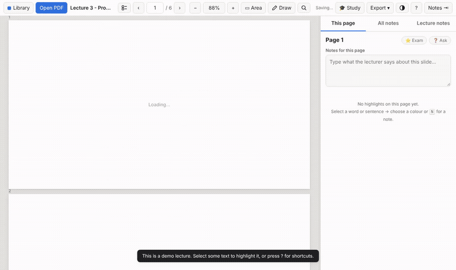
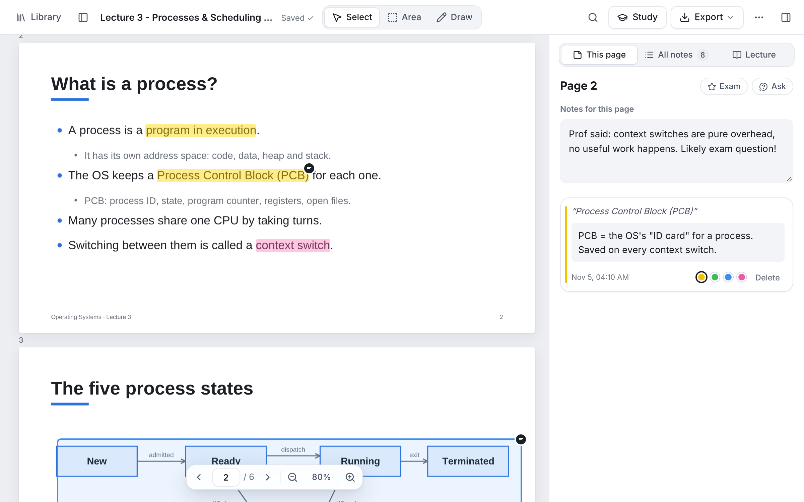
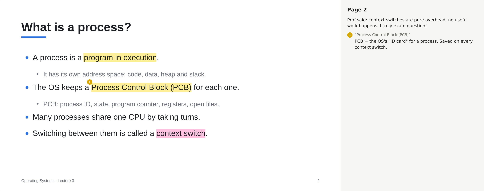
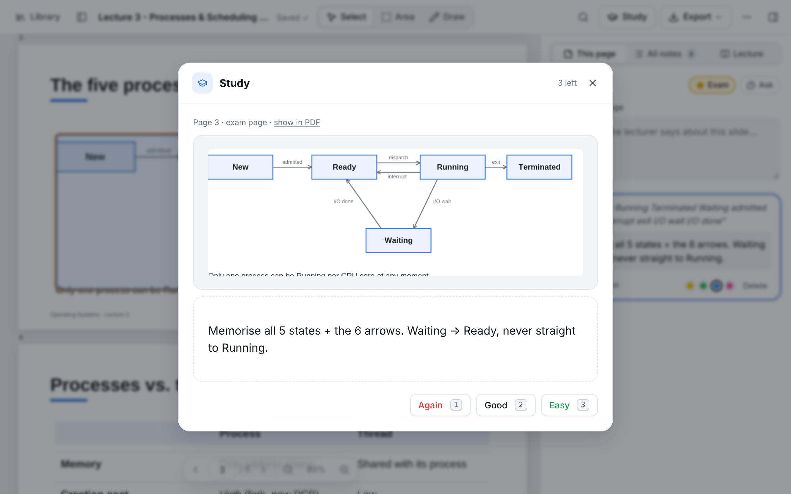
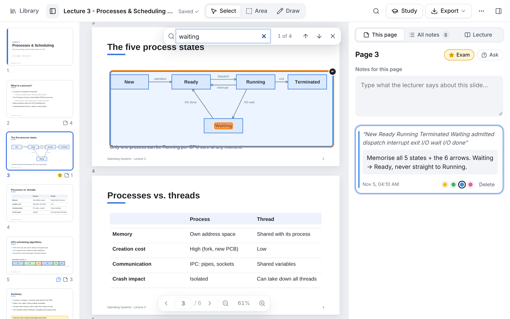

<p align="center">
  
</p>

<h1 align="center">uni-pdf</h1>

<p align="center">
  <strong>Your lecture notes, right on the slides.</strong><br>
  A free, private PDF reader for lectures. Highlight slides, attach notes to any sentence or diagram,<br>
  and export one PDF with your notes printed next to every slide.
</p>

<p align="center">
  <a href="https://arsimsaliu.github.io/uni-pdf/app/"><strong>Open the app</strong></a> ·
  <a href="https://arsimsaliu.github.io/uni-pdf/">Homepage</a> ·
  <a href="https://github.com/ArsimSaliu/uni-pdf/releases/latest">Offline download</a> ·
  <a href="https://github.com/ArsimSaliu/uni-pdf/issues/new/choose">Report a problem</a>
</p>

<p align="center">
  <a href="https://github.com/ArsimSaliu/uni-pdf/actions/workflows/ci.yml"></a>
  
  
  
</p>

<p align="center">
  
</p>

## Why

In a lecture you have the slides in one window and your notes in another, and afterwards the two never quite line up. uni-pdf puts a notes panel next to the slide you're on, ties each note to the exact sentence or diagram it's about, and gives you one tidy PDF at the end.

- **Notes anchored to text.** Select a sentence, press <kbd>N</kbd>, and type. Hover the highlight later to read the note.
- **Area notes** for diagrams, formulas and images (<kbd>A</kbd>, or <kbd>Alt</kbd> + drag).
- **Draw on slides** with a pen or highlighter (<kbd>D</kbd>), using a mouse, a touchscreen or a stylus.
- **A notes field for each slide**, plus general notes for the whole lecture.
- **Search the slides** (`Ctrl+F`) and **search every note**, in one lecture or across your whole library.
- **Study mode:** your highlights and notes become flashcards with spaced repetition, and you can export them to **Anki**.
- **Flag slides** as ⭐ exam-relevant or ❓ question to ask, and filter by them.
- **Page thumbnails and outline** for jumping around long decks.
- **Export** a PDF with numbered highlights and a notes column, an *editable* PDF that you can reopen here, Markdown, or a JSON backup.
- **Private.** No server, account, analytics or uploads. Everything stays in your browser.
- **Works offline**, can be installed as an app (PWA), has dark mode, and works on phones and tablets.

| | |
|---|---|
|  |  |
| Slide with highlights and the notes panel | The exported PDF, with notes next to the slide |
|  |  |
| Study mode: your notes as flashcards | Search in the slides, with page thumbnails |

## Get started

**Online (recommended):** open **https://arsimsaliu.github.io/uni-pdf/app/** and click *Try the demo lecture*. In Chrome or Edge you can also install it (the install icon in the address bar) so it gets its own window, works offline, and opens PDFs from your file manager.

**Offline / USB stick:** download `uni-pdf.zip` from the [latest release](https://github.com/ArsimSaliu/uni-pdf/releases/latest), unzip it, and double-click **`index.html`**. Nothing needs to be installed and you don't need internet.

> Notes are saved in the browser you open uni-pdf with. Keep using the same browser, and the same way of opening it (online or the same `index.html`), or your notes won't show up. Use **Export → Backup** to keep a copy.

## How to use

| Action | How |
|---|---|
| Open a PDF | **Open PDF** button, <kbd>O</kbd>, or drag a PDF onto the window |
| Note on a word/sentence | Select the text → **✎ Note** (or press <kbd>N</kbd>) |
| Highlight only | Select the text → click a colour (or press <kbd>H</kbd>) |
| Note on a diagram/image | **▭ Area** (or <kbd>A</kbd>, or hold <kbd>Alt</kbd> while dragging) and drag a box |
| Draw on the slide | **✏ Draw** or <kbd>D</kbd>: pen, highlighter, eraser, 5 colours, 3 sizes. <kbd>Ctrl</kbd>+<kbd>Z</kbd> undo, <kbd>Esc</kbd> done. Click a drawing afterwards to add a note |
| Note for the whole page/slide | Press <kbd>P</kbd> or type in *Notes for this page* |
| General notes for the lecture | **Lecture notes** tab |
| See/search everything | **All notes** tab |
| Jump to a highlight | Click it in the sidebar. Clicking a highlight in the PDF opens its note |
| Undo a delete | Click **Undo** in the message that appears |
| Search the slides | <kbd>Ctrl</kbd>+<kbd>F</kbd>, then <kbd>Enter</kbd> / <kbd>Shift</kbd>+<kbd>Enter</kbd> for next / previous |
| Mark a slide | <kbd>E</kbd> ⭐ exam-relevant · <kbd>Q</kbd> ❓ question to ask (or the buttons in the notes panel) |
| Study with flashcards | **🎓 Study** or <kbd>S</kbd>. Every highlight with a note is a card. *Export → Flashcards for Anki* for Anki |
| Page thumbnails / outline | Toolbar button or <kbd>T</kbd> |
| Search all lectures | Search box in the library |
| Back up everything | Library → *Back up everything* (all PDFs and notes in one file) |

**Keys:** <kbd>←</kbd>/<kbd>→</kbd> previous/next page · <kbd>T</kbd> thumbnails · <kbd>S</kbd> study · <kbd>+</kbd>/<kbd>-</kbd>/<kbd>0</kbd> zoom/fit · <kbd>Ctrl</kbd>+scroll zoom · <kbd>\\</kbd> hide/show the notes panel · <kbd>L</kbd> library · <kbd>?</kbd> all shortcuts · <kbd>Esc</kbd> leave a text box

## Your data

- PDFs and notes are stored only on this device, in the browser's IndexedDB. Nothing is uploaded. See [PRIVACY.md](PRIVACY.md).
- Each PDF is identified by its contents. Opening the same file again, even from another folder or after downloading it again, brings back its notes.
- **Export → PDF with highlights & notes** saves a real PDF: each slide with your highlights drawn on it (numbered), and a notes column on the right with that page's notes. Long notes continue on an extra page, and your lecture notes go at the end. The slide text stays selectable and searchable.
- **Export → Editable PDF** looks the same in any PDF reader, but it also carries the original slides and your notes inside it. Open it in uni-pdf again, even on another computer or after clearing the browser, and you get the clean slides back with every note and highlight editable. If the app already has different notes for that lecture, it asks which version to keep.
- **Export → Notes as Markdown** saves study-friendly notes for Obsidian, Notion and similar apps. **Export → Backup** saves a `.json` file you can restore later, which is worth doing before you clear browser data.

## Development

uni-pdf is plain HTML, CSS and JavaScript with no build step and no framework. The app in `app/` runs as-is.

```bash
npm install          # dev tools only (Playwright, ESLint)
npm start            # http://localhost:8080/app/  (homepage at /)
npm test             # end-to-end tests in Chromium
npm run lint
```

| Path | What |
|---|---|
| `app/` | The app: `index.html`, `styles.css`, `app.js`, `export-pdf.js` (builds the annotated PDF), `sw.js` (offline cache), `manifest.webmanifest` |
| `app/vendor/` | Bundled so everything works offline: [pdf.js](https://github.com/mozilla/pdf.js) 3.11.174 (Apache-2.0), [pdf-lib](https://pdf-lib.js.org) 1.17.1 + fontkit (MIT), DejaVu Sans (free licence, covers Greek and maths symbols) |
| `site/` | The homepage, deployed to GitHub Pages together with the app |
| `scripts/` | `serve.js`, `build-site.js` (→ `_site/` and `dist/uni-pdf.zip`), `make-sample.js` (demo lecture), `screenshots.js` (homepage images and demo video), `make-icons.js`, `bump-version.js` |
| `tests/` | Playwright tests: highlighting, notes, persistence, every export, editable-PDF round trip, offline mode, `file://` mode, search, thumbnails, flags, study mode, Anki export, library search and full backup |
| `marketing/` | Launch kit: copy for Product Hunt, Hacker News, Reddit, social media and more |

### Releasing

1. Add a section for the new version to [CHANGELOG.md](CHANGELOG.md).
2. `npm run version -- 1.1.0` updates the version in the app, the service worker cache and `package.json`.
3. Commit, then `git tag v1.1.0 && git push origin main --tags`.

GitHub Actions then runs the tests, publishes a GitHub release with `uni-pdf.zip` attached, and redeploys the website. One-time setup: under **Settings → Pages**, set **Source** to **GitHub Actions**.

## Contributing

Bug reports and ideas from students are very welcome. See [CONTRIBUTING.md](CONTRIBUTING.md).

## License

uni-pdf's own code is public domain ([Unlicense](LICENSE)). The bundled libraries and fonts keep their own licences: see [app/vendor/THIRD-PARTY-NOTICES.md](app/vendor/THIRD-PARTY-NOTICES.md).

uni-pdf is an independent project. It isn't affiliated with Adobe, Anki or any other product mentioned in this repository, and their names are used only to describe compatibility.
